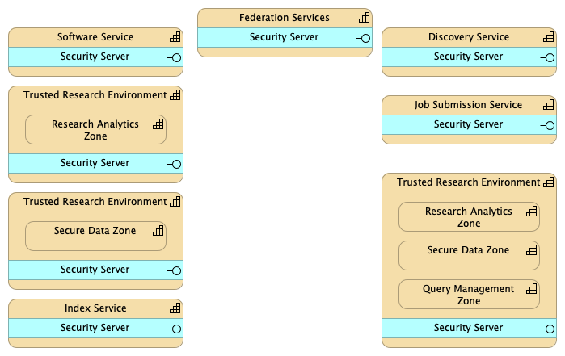

# Module 1: TRE Architecture and Fundamentals

<strong>Audience:</strong> TRE Providers and TRE Users

## What is a TRE?

A **Trusted Research Environment (TRE)** is a secure digital workspace that provides researchers with controlled access to sensitive data (such as health, social, or administrative records) while ensuring strict safeguards around privacy, security, and compliance. TREs function like protected reference libraries, giving approved researchers a single, secure location for both data and analytical tools. For definitions of key terms, see the [Glossary](appendices/glossary.md).

### Core Characteristics of TREs

- **Data protection:** Prevent data from being copied or removed. Allow researchers to access only the tools and views needed for analysis.

- **Controlled access:** Authenticate users and assign permissions so only approved researchers can enter.

- **Secure compute:** Perform analysis in a segregated, auditable environment (often virtual desktops or containers).

- **Governed outputs:** Check results before releasing them to ensure you do not compromise data subjects.

- **Compliance:** Follow legal and ethical frameworks such as GDPR, ISO 27001, or national research governance.

### Why TREs Matter

TREs balance research access with the need to protect sensitive data. They support reproducible, large-scale studies while maintaining privacy and trust. For more on federation and interoperability, see [Federation Integration](./federation.md). For an overview of the technical and organizational structure, see the [Reference Architecture](appendices/reference-architecture.md).

### What is the difference between a Secure Processing Environment (SPE) and a Trusted Research Environment (TRE)?

- **Mapping type:** Functional correspondence.
- **Meaning:** Both terms describe controlled settings for work with sensitive data. They are not synonyms: SPE has a legal definition under the Data Governance Act and specific EHDS requirements, while TRE is used for a broader class of systems and governance practices in the UK TRE Glossary. Treating them as functionally corresponding is this guide's interpretation.
- **Sources:**
    - EU: [Data Governance Act Article 2(20)](https://eur-lex.europa.eu/legal-content/EN/TXT/?uri=CELEX:32022R0868) defines an SPE; [EHDS Article 73](https://eur-lex.europa.eu/legal-content/EN/TXT/?uri=CELEX:32025R0327) specifies requirements for EHDS secondary use.
    - UK: The [UK TRE Glossary: Trusted Research Environment](https://glossary.uktre.org/en/latest/#term-trusted-research-environment--tre-) defines the TRE term and relates it to Five Safes governance.

## What are the important zones in a TRE?

### TRE Functional Zones: RAZ, SDZ, and QMZ

The EOSC-ENTRUST builds on efforts and experience gathered in the DARE-UK project. DARE-UK suggests a subdivision of a TRE  into three functional zones, reflecting different governance and security contexts. A TRE may contain one or more of these zones.

DARE-UK blueprint based on SATRE and Five Safes, commonly agreed minimal standards. TREs have at least one of three capabilities: Research Analytics Zones (RAZs), Secure Data Zones (SDZs), and Query Management Zones (QMZs). We illustrate three possible TRE configurations: a RAZ-only TRE, a SDZ-only TRE, and a TRE with all three zones. (D13.3 Year one version of EOSC-ENTRUST Blueprint & Interoperability Framework)

#### Research Analytics Zone (RAZ)

The RAZ provides the environment for Project Members to access approved data for analysis. Include one or more Project Environments in the RAZ. If the RAZ supports remote data presentations, support the Query (direct) and incoming Response interface types. The ENTRUST RAZ model includes the Principal Investigator (PI) acting as both the Output Approver and Input Approver for the project environment. This modification avoids infrastructure scalability bottlenecks and clarifies legal responsibility, especially where the TRE is not the data controller. The RAZ is comparable to the European Health Data Space's (EHDS) Secure Processing Environment (SPE) concept.

#### Secure Data Zone (SDZ)

The SDZ manages, links, curates, ingresses, and egresses research-ready sensitive datasets. Include a Data Management function in the SDZ. Route all data movements to or from the SDZ through the Data Management function. Grant Data Manager and Output Approver roles access to the SDZ; do not grant access to other roles. Support the Data Egress and Data Ingress interface types in the SDZ for sending and receiving Data Extract Objects. The ENTRUST architecture includes the Secure Data Archive (SDA) as a specialized SDZ that stores published Curated Data and handles Data Access Requests to such published data. Assign unique IDs and accompanying metadata to Curated Data to enable credit attributions.

#### Query Management Zone (QMZ)

The QMZ handles queries sent from other, remote TREs or external Job Submission services, typically sitting alongside an SDZ. For direct queries, include an External Presentation component (e.g., a database view) and support the incoming Query (direct) interface type. For indirect queries, include a Job Controller component and a Job Executor component, and route the Job Request through a Job Approval process. Provide a High-Performance Computing (HPC) component in the QMZ to support the execution of indirect query jobs.

### What is the description of the TREs in the Blueprint based on?

The DARE-UK blueprint describing a TRE is built on the standards from both SATRE and Five Safes and has been an important inspiration to describing the EOSC-ENTRUST Blueprint and how TREs are being built up.

**SATRE** (The Standard Architecture for TREs) is a DARE UK funded activity to establish a community-driven specification and assurance framework for TREs to self-evaluate themselves against. It is based upon the core principles of Usability, Public Trust, Observability and Standardisation ensuring that TREs are not only secure and compliant but also accessible to researchers and trustworthy to the public. SATRE uses a Capability framework broken down by specific statements and provides a comprehensive framework for building, operating, and evaluating TREs across academia, healthcare, industry, and government.

For more information, see [SATRE Specification](https://satre-specification.readthedocs.io/en/stable/)

**The Five Safes framework** is a set of principles enabling data services to provide safe research access to data. It has become the best practice in data protection whilst also fulfilling the demands of open science and transparency. See [Five Safes](https://fivesafes.org/)

The Five Safes break down the decisions surrounding data access and use into five related, but separate, dimensions:

- [Safe projects](https://fivesafes.org/the-five-safes/safe-projects/) – is this use of data appropriate, lawful, ethical and sensible?
- [Safe people](https://fivesafes.org/the-five-safes/safe-people/) – can the user/s be trusted to use the data in an appropriate manner?
- [Safe data](https://fivesafes.org/the-five-safes/safe-data/) – is there a disclosure risk in the data itself?
- [Safe settings](https://fivesafes.org/the-five-safes/safe-settings/) – does the access facility limit unauthorised use or mistakes?
- [Safe outputs](https://fivesafes.org/the-five-safes/safe-outputs/) – are the statistical results non-disclosive?

All five 'safes' must be considered jointly to evaluate whether a data access system provides an 'acceptable' solution.

