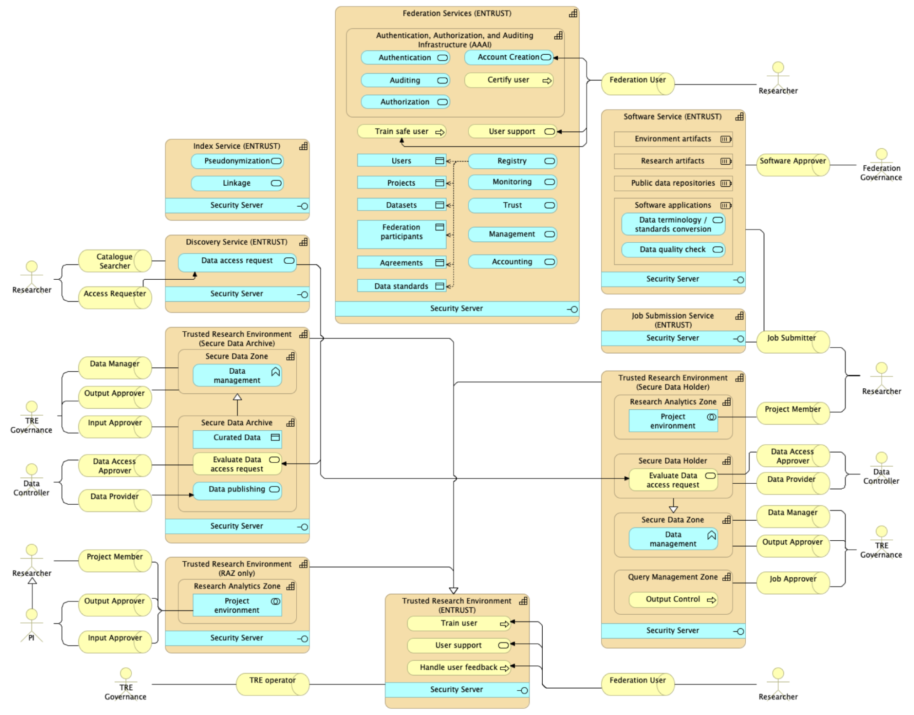
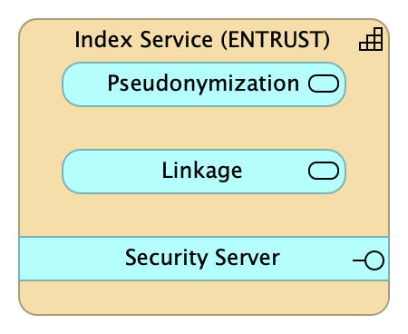
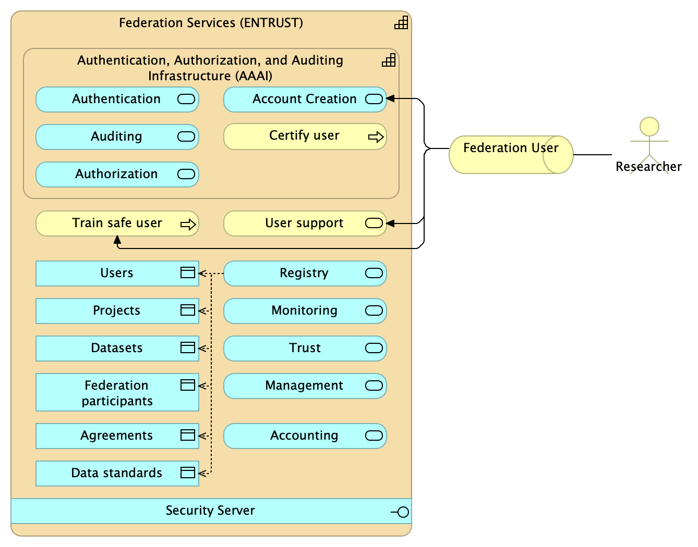
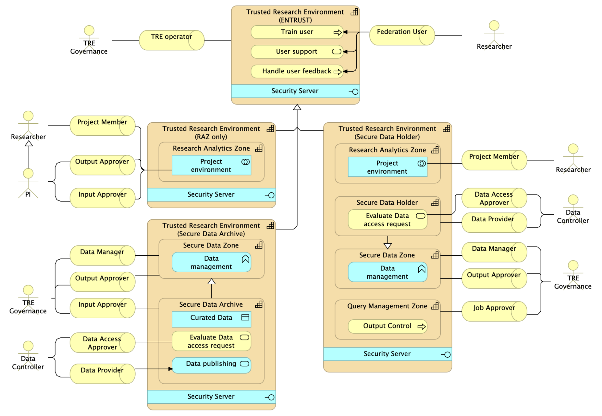

# Module 3: Blueprint Architecture

<strong>Audience:</strong> Federation Operators, TRE Builders, and TRE operators

This section introduces the infrastructure layer of the ENTRUST Blueprint, detailing the Participants and the minimal requirements for creating a trustworthy federation.

## Design Philosophy

The architecture follows the principle of *"start from where you are"* and proposes the *minimum necessary new infrastructure* required to connect TREs. It is explicitly a "back end" architecture; researchers interact only with TREs, not the Federation infrastructure directly.

**A minimal baseline, not a single stack**.
The architecture is part of the ENTRUST Blueprint, which describes *the minimal requirements* for joining a federation of TREs. It does not prescribe a single technology stack or ask providers to replace what they already operate. Instead, it defines the capabilities, roles, and interfaces that every participating TRE must support, so that existing environments can interoperate without being rebuilt.

**Trust through shared AAAI**.
Federation depends on participants trusting each other's decisions about who a user is, what they may do, and what has happened. The architecture therefore centres on *a common Authentication, Authorization, and Auditing Infrastructure (AAAI)*, together with defined interfaces for exchanging data objects between federation participants.

**Grounded in real use cases**.
The architecture has been validated and revised against the requirements of the ENTRUST Driver use cases. Gaps and additional needs identified during that validation were fed back into the current specification, so the design *reflects practical implementation experience* rather than theory alone.

**Aligned with European developments**.
Where appropriate, the architecture is aligned with ongoing developments in the European Health Data Space (**EHDS**) and the European Open Science Cloud (**EOSC**). For example, the Research Analytics Zone is comparable to the EHDS Secure Processing Environment.

**Built to evolve**.
The design is intended as a foundation for future scaling, alignment with domain-specific initiatives, and long-term sustainability of the EOSC-ENTRUST framework. It is an evolving specification: this version is the second iteration, and later versions will build on feedback from implementers.

## Federation Participants

Participants are the strategic capabilities forming the federation network.

### Federation Participants

- **Trusted Research Environment (TRE)**
    - *Function*: Primary vehicle for delivering sensitive data to researchers in a secure, controlled, and approved manner.
    - *Key Components*: Research Analytics Zone (RAZ), Secure Data Zone (SDZ), Query Management Zone (QMZ).

- **Index Service**
    - *Function*: Creates linkage spines to link distinct datasets at the individual level, enabling authorized joint datasets.
    - *Key Components*: Pseudonymization service, Linkage spines registry.

- **Software Service**
    - *Function*: Provides approved software artifacts, including environment configurations and research artifacts (workflows, containers).
    - *Key Components*: Environment Artifacts, Research Artifacts.

- **Discovery Service**
    - *Function*: Provides information (metadata) about features of the Federation to users outside the Federation, potentially querying the Registry.
    - *Key Components*: Output Control process.

- **Job Submission Service**
    - *Function*: Receives job requests (indirect queries) from researchers and manages forwarding and result handling.
    - *Key Components*: Job Approval process, Output Control process.

- **Federation Services**
    - *Function*: Provides coordinating functions: Registry, Trust, Accounting, Management, and Monitoring.
    - *Key Components*: AAAI Capability, Registry.

## Interoperability Requirement

Maintain integrity, non-repudiation, and traceability in the federation. Register all Projects with the Federation's Registry services, and assign globally recognizable and unique Project Identities.

## The Entrust Blueprint for federated TREs

The ENTRUST Infrastructure architecture, v.3, is including the revised components Index Service and Federation Services

<em>ENTRUST Infrastructure architecture, v3.</em>

<em>ENTRUST Index Service.</em>

Linkage application service that provides individual-level linking of datasets that can then be implemented according to local legal frameworks. A cross-national federation will then typically consist of multiple, national or regional Index Services, each potentially having its own Linkage service implementation.

<em>ENTRUST Federation Services.</em>

All federations should maintain a registry of data standards that the federation supports.

<em>ENTRUST Trusted Research Environments.</em>

There are three user-facing functionalities. These functionalities are available to all Federation Users. Possible TRE configurations are then modelled as specializations of the general Trusted Research Environment. The architecture illustrates the three possible TRE configurations: the RAZ only TRE, the Secure Data Archive TRE, and the Secure Data Holder TRE including all three zones: RAZ, SDZ and QMZ. 
